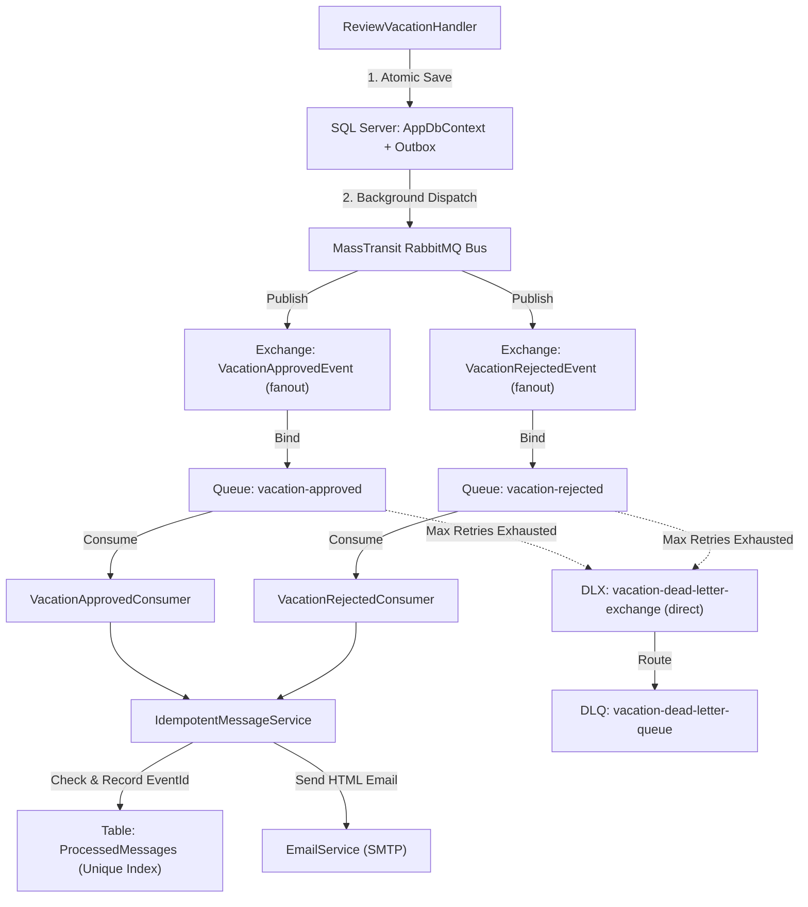

# 🏢 Employee Management System (EMS)

<div align="center">


**An enterprise-grade ASP.NET Core Web API (.NET 10) for end-to-end HR, Payroll, Leave Management, and Reliable Event-Driven Notifications.**

[Overview](#-overview--business-value) • [Problems Solved](#-problems-solved) • [Architecture](#-architecture--design-patterns) • [Core Modules](#-core-modules) • [RabbitMQ Topology](#-rabbitmq-topology--reliability) • [Getting Started](#-getting-started) • [API Reference](#-api-reference)

</div>

---

## 📌 Overview & Business Value

The **Employee Management System (EMS)** is a production-oriented backend platform designed to centralize and automate core Human Resources and Payroll operations. Built with **.NET 10**, **Clean Architecture**, **CQRS (MediatR)**, **Entity Framework Core**, and **RabbitMQ (via MassTransit)**, the system goes beyond basic CRUD by solving real-world distributed systems and financial integrity challenges.

### 🎯 Key Highlights for Engineering & Technical Reviewers
- **Clean Architecture & Separation of Concerns:** Strictly decoupled `Domain`, `Application`, `Infrastructure`, `Host`, and `Tests` layers.
- **Financial Data Integrity:** Automated monthly payroll generation with cross-month overtime attribution, historical immutability (`Draft → Approved → Paid`), and database-level uniqueness constraints.
- **Resilient Event-Driven Messaging:** Leave approval/rejection notifications use the **Transactional Outbox Pattern**, **Incremental Retries**, **Dead Letter Exchanges/Queues (DLX/DLQ)**, and a **Database-Backed Idempotency Engine** with concurrency locking.
- **DevOps Ready:** Multi-stage `Dockerfile`, full-stack `docker-compose.yml` (API + SQL Server + RabbitMQ with health checks), and automated **GitHub Actions CI/CD** pipeline.
- **Automated Test Coverage:** 18 xUnit tests covering payroll calculations, cross-month overtime splitting, idempotency, concurrent duplicate deliveries, retries, and DLQ routing.

---

## 💡 Problems Solved

| Challenge | How This Project Solves It |
| :--- | :--- |
| **Tight Coupling & Unmaintainable Controllers** | Implements **Clean Architecture + CQRS with MediatR**, isolating domain rules from infrastructure concerns and keeping API controllers thin. |
| **Inaccurate Cross-Month Overtime Payroll** | `PayrollCalculator` splits multi-day overtime records across month boundaries using inclusive date intersections, attributing only the days falling within the target payroll period. |
| **Retroactive Payroll Corruption** | Stores calculated salaries as immutable historical snapshots once `Approved` or `Paid`, preventing later changes in `BasicSalary` or `RatePerDay` from altering past payslips. |
| **Duplicate Payroll Generation** | Enforces a composite unique index on `(EmployeeId, Month, Year)` in SQL Server, plus batch generation safeguards. |
| **Lost Events on Broker Outage** | Uses **MassTransit EF Core Transactional Outbox** so vacation status updates and outgoing events commit atomically in the same SQL Server transaction. |
| **Duplicate Email Notifications & Race Conditions** | Every event carries a unique `EventId` (`GUID`). `IdempotentMessageService` checks a unique-indexed `ProcessedMessages` table, coordinates concurrent deliveries via `SemaphoreSlim`, and never marks failed operations as processed. |
| **Infinite Retry Loops / Poison Messages** | Configures incremental retries (`2s`, `5s`, `8s`, max 3 attempts) and routes exhausted messages to `vacation-dead-letter-queue` via `vacation-dead-letter-exchange`. |

---

## 🛠️ Tech Stack

| Category | Technology | Purpose |
| :--- | :--- | :--- |
| **Framework & Language** | .NET 10 (`net10.0`), C# | High-performance Web API backend |
| **Architecture & Patterns** | Clean Architecture, CQRS, MediatR, Repository Pattern | Modularity, testability, and maintainability |
| **Database & ORM** | SQL Server 2022, Entity Framework Core 10.0 | Relational persistence, migrations, decimal precision, unique indexes |
| **Messaging & Outbox** | RabbitMQ 3, MassTransit 8.3.6 (`MassTransit.RabbitMQ`, `MassTransit.EntityFrameworkCore`) | Asynchronous event bus, Transactional Outbox/Inbox, DLX/DLQ |
| **Security & Auth** | ASP.NET Core Identity, JWT Bearer Authentication, Refresh Tokens | Role-based access control (`Admin`, `User`) & stateless API auth |
| **Object Mapping** | AutoMapper 13.0.1, Mapster 10.0.14 | DTO-to-Entity transformations |
| **Logging & Diagnostics** | Serilog (`Serilog.AspNetCore` 11.0.0) + Global Exception Middleware | Structured logging without leaking sensitive employee data |
| **Containerization & CI/CD** | Docker, Docker Compose, GitHub Actions | Reproducible environments, automated build/test/publish/image validation |
| **Testing** | xUnit 2.9.3, Moq 4.20.72, EF Core InMemory 10.0.11 | Unit & concurrency tests |

---

## 🏛️ Architecture & Design Patterns

```text
┌─────────────────────────────────────────────────────────────────────────┐
│                             Host (Web API)                              │
│   15 REST Controllers • JWT Auth • Swagger UI • Serilog • Middleware    │
└────────────────────────────────────┬────────────────────────────────────┘
                                     │ MediatR (Commands / Queries)
                                     ▼
┌─────────────────────────────────────────────────────────────────────────┐
│                            Application Layer                            │
│  DTOs • Mapping Profiles • CQRS Contracts • Event Contracts • Settings  │
└────────────────────────────────────┬────────────────────────────────────┘
                                     │ Interfaces
                                     ▼
┌─────────────────────────────────────────────────────────────────────────┐
│                          Infrastructure Layer                           │
│  AppDbContext • EF Migrations • Repositories • MediatR Handlers         │
│  PayrollCalculator • EmailService • IdempotentMessageService            │
│  MassTransit Outbox • RabbitMQ Consumers (Retry + DLX/DLQ)              │
└────────────────────────────────────┬────────────────────────────────────┘
                                     │ References
                                     ▼
┌─────────────────────────────────────────────────────────────────────────┐
│                              Domain Layer                               │
│   Entities (Employee, Payroll, Vacation, OverTime, Sanction, Doctor,    │
│   ProcessedMessage, Org/Location) • Enums (PayrollStatus, VacationStatus│
└─────────────────────────────────────────────────────────────────────────┘
```

---

## 🧩 Core Modules

### 1. Payroll Management Module
Automates monthly employee salary calculation using the formula:

$$\text{NetSalary} = \text{BasicSalary} + \text{Allowances} + \text{OverTimeAmount} - \text{Deductions}$$

- **Automatic Salary & Rate Lookup:** Pulls `BasicSalary` from `Employee` and `RatePerDay` from `OverTimeType` automatically.
- **Inclusive & Cross-Month Overtime:** Calculates inclusive days `(EndDate - StartDate) + 1` and intersects overtime ranges with the target payroll month/year.
- **Sanction Deductions:** Aggregates `DeductionAmount` from `Sanction` records matching the payroll month/year by `PunishmentDate` (ignoring zero-deduction warnings).
- **Lifecycle & Immutability:**
  - `Draft (1)`: Editable and deletable for review.
  - `Approved (2)`: Locked against edits or deletion.
  - `Paid (3)`: Locked and stamped with `PaymentDate`.
- **Negative Net Salary Handling:** If deductions exceed total earnings, payroll is created as `Draft` with an explicit warning rather than failing silently or auto-approving.

### 2. Vacation Approval Workflow
- Employees submit leave requests; admins review pending requests via `ReviewVacationHandler` (`Pending → Approved / Rejected`).
- Decisions persist alongside a `VacationApprovedEvent` or `VacationRejectedEvent` (with a generated `Guid EventId`) in the **MassTransit EF Core Outbox**.

### 3. Reliable Messaging (Retry + Idempotency + DLQ)
- **Idempotency:** `ProcessedMessage` entity backed by a unique index on `EventId`. `IdempotentMessageService` guards against duplicates, uses `SemaphoreSlim` for in-process concurrent delivery safety, and executes business operations before committing the processed marker in a SQL Server transaction.
- **External Email Semantics:** Acknowledges at-least-once delivery for SMTP emails—if email delivery succeeds but DB commit fails, the message retries rather than falsely marking as processed.
- **Retry & Dead-Lettering:** Incremental retries (`MaxRetryAttempts: 3`, `InitialIntervalSeconds: 2`, `IntervalIncrementSeconds: 3`) configured via `appsettings.json`. Exhausted messages route to `vacation-dead-letter-queue` via `vacation-dead-letter-exchange`.

### 4. Employee, Organization, Locations, Overtime, Sanctions & Medical
- **Employee:** Profiles, `BasicSalary`, email, search, and organizational assignment.
- **Organization Hierarchy:** `GeneralDepartment → Department → Branch`.
- **Geography:** `Country → City → Town`.
- **Time & Conduct:** `OverTime` / `OverTimeType`, `Sanction` / `SanctionType`.
- **Medical:** `Doctor` records (`MedicalDiagnose`, `MedicalRecommendation`) per employee.
- **Authentication:** ASP.NET Core Identity, JWT generation, Role-Based Authorization, and Refresh Token rotation.

---

## 📬 RabbitMQ Topology & Reliability



Configuration in `Host/appsettings.json`:
```json
"RabbitMqSettings": {
  "Host": "localhost",
  "VirtualHost": "/",
  "Username": "guest",
  "Password": "guest",
  "Port": 5672,
  "Retry": {
    "MaxRetryAttempts": 3,
    "InitialIntervalSeconds": 2,
    "IntervalIncrementSeconds": 3,
    "VacationApprovedQueue": "vacation-approved",
    "VacationRejectedQueue": "vacation-rejected",
    "DeadLetterExchange": "vacation-dead-letter-exchange",
    "DeadLetterQueue": "vacation-dead-letter-queue"
  }
}
```

---

## 📂 Project Structure

```text
EmployeeSystem/
├── Domain/
│   ├── Entities/                  # Employee, Payroll, Vacation, OverTime, Sanction, Doctor, ProcessedMessage, Org/Location
│   └── Entities/Enum/             # PayrollStatus, VacationStatus
├── Application/
│   ├── Dtos/                      # AccountDto, Request/*, Response/*
│   ├── Helper/                    # Constants, JwtSection, EmailSettings, RabbitMqSettings, RabbitMqRetrySettings
│   ├── Mapping/                   # AutoMapper profiles
│   └── Service/
│       ├── Contracts/             # Repository interfaces, Events, IIdempotentMessageService, IPayrollCalculator, IAppLogger
│       └── */                     # CQRS Commands & Queries per module
├── Infrastructure/
│   ├── Consumers/                 # VacationApprovedConsumer, VacationRejectedConsumer
│   ├── DataAccess/                # AppDbContext, DbInitializer
│   ├── DependencyInjection/       # ServiceContainer (DI, MassTransit, RabbitMQ topology)
│   ├── Handler/                   # MediatR Command & Query Handlers
│   ├── Middleware/                # ExceptionHandlingMiddleware
│   ├── Migrations/                # EF Core Migrations (incl. Outbox, Payroll, ProcessedMessages)
│   ├── Repositories/              # GenericRepository & specialized repositories
│   └── Services/                  # AuthenticationService, EmailService, IdempotentMessageService, PayrollCalculator, SerilogLoggerAdapter
├── Host/
│   ├── Controllers/               # 15 RESTful API Controllers
│   ├── Program.cs                 # App startup, Swagger, Auth, Middleware
│   └── appsettings.json           # Connection strings, JWT, Email, RabbitMQ & Retry config
├── Tests/
│   └── EmployeeSystem.Tests/      # xUnit test suite (18 passing tests)
├── .github/workflows/
│   ├── ci.yml                     # GitHub Actions CI pipeline (Build, Test, Docker validation)
│   └── cd.yml                     # GitHub Actions CD pipeline (Publish & Release image)
├── Dockerfile                     # Multi-stage .NET 10 build & runtime image
├── .dockerignore
├── docker-compose.yml             # API + SQL Server 2022 + RabbitMQ 3-Management
└── EmployeeSystem.slnx
```

---

## 🐳 Docker & CI/CD

### Docker Compose Stack (`docker-compose.yml`)
Orchestrates three services with health checks:
1. **`sqlserver`** (`mcr.microsoft.com/mssql/server:2022-latest`) on port `1433`
2. **`rabbitmq`** (`rabbitmq:3-management`) on ports `5672` (AMQP) and `15672` (Management UI)
3. **`api`** (built from multi-stage `Dockerfile`) on port `5000:8080`, starting only after `sqlserver` and `rabbitmq` pass health checks.

### GitHub Actions Pipelines (`.github/workflows/ci.yml` & `cd.yml`)
- **CI (`.github/workflows/ci.yml`)** — Triggered on `push` and `pull_request` to `master` / `main`:
  1. **`build-and-test`**: Checks out code, sets up .NET 10 SDK, caches NuGet packages, restores, builds in `Release`, runs all unit tests, and uploads `.trx` test results.
  2. **`docker-validation`**: Validates the multi-stage `Dockerfile` using Docker Buildx.
- **CD (`.github/workflows/cd.yml`)** — Triggered automatically after **CI Pipeline** succeeds on `master` / `main` (or via `workflow_dispatch`):
  1. **`publish-artifact`**: Publishes `Host/Host.csproj` and uploads the deployable API binary artifact.
  2. **`docker-release`**: Builds the release Docker image (`employeesystem-api:latest`).

---

## 🧪 Automated Test Suite

The test suite in `Tests/EmployeeSystem.Tests/` contains **18 passing unit tests**:

| Test File | Verified Scenarios |
| :--- | :--- |
| `IdempotencyTests.cs` | New message execution & recording, duplicate suppression, failed operations not marked processed (allowing retry), and 5-way concurrent duplicate delivery safety. |
| `ConsumerRetryAndDlqTests.cs` | Approval/rejection email sending & ACK, duplicate suppression without resending email, temporary failure rethrow for retry, success after retry, and DLQ transfer logging on max attempts. |
| `PayrollCalculationUnitTests.cs` | Net salary formula across scenarios, default `Draft` status, and cross-month overtime day attribution. |
| `VacationAndOvertimeUnitTests.cs` | Inclusive single-day & multi-day overtime calculations and vacation end-date calculation. |

Run all tests locally:
```bash
dotnet test Tests/EmployeeSystem.Tests/EmployeeSystem.Tests.csproj --verbosity normal
```

---

## 🏁 Getting Started

### Prerequisites
- [.NET 10 SDK](https://dotnet.microsoft.com/download/dotnet/10.0)
- [Docker Desktop](https://www.docker.com/products/docker-desktop/) *(for containerized setup)*, **or** local SQL Server & RabbitMQ instances.

### Option 1: Run Full Stack with Docker Compose (Recommended)
```bash
git clone https://github.com/AhmedSaye2d/EmployeeSystem.git
cd EmployeeSystem
docker-compose up -d --build
```
- **API & Swagger UI:** `http://localhost:5000/swagger`
- **RabbitMQ Management:** `http://localhost:15672` (`guest` / `guest`)
- **SQL Server:** `localhost:1433`

### Option 2: Run Locally
```bash
dotnet restore
dotnet ef database update --project Infrastructure --startup-project Host
dotnet run --project Host
```

---

## 📡 API Reference

### Payroll (`/api/Payroll`) — *Admin Only*
| Method | Endpoint | Description |
| :--- | :--- | :--- |
| `GET` | `/api/Payroll/all` *(or `/api/Payroll`)* | Retrieve all payroll records |
| `GET` | `/api/Payroll/{id}` | Retrieve payroll record by ID |
| `GET` | `/api/Payroll/employee/{employeeId}` | Retrieve payroll history for an employee |
| `GET` | `/api/Payroll/period?month={m}&year={y}` | Retrieve payrolls for a specific month & year |
| `POST` | `/api/Payroll` | Create payroll for a single employee |
| `POST` | `/api/Payroll/generate-monthly` | Batch-generate monthly payrolls for multiple employees |
| `PUT` | `/api/Payroll/draft` | Update a `Draft` payroll record |
| `PUT` | `/api/Payroll/{id}/approve` | Approve a payroll (locks edits) |
| `PUT` | `/api/Payroll/{id}/pay` | Mark payroll as `Paid` and record `PaymentDate` |
| `DELETE` | `/api/Payroll/{id}` | Delete a `Draft` payroll record |

### Vacations (`/api/Vacation`)
| Method | Endpoint | Description |
| :--- | :--- | :--- |
| `GET` | `/api/Vacation/all` | List all vacation requests |
| `GET` | `/api/Vacation/{id}` | Get vacation by ID |
| `GET` | `/api/Vacation/employee/{employeeId}` | Get vacations for an employee |
| `GET` | `/api/Vacation/pending` | List pending vacation requests |
| `POST` | `/api/Vacation/add` | Submit a new vacation request |
| `PUT` | `/api/Vacation/review` | Review (approve/reject) vacation & publish Outbox event |
| `PUT` | `/api/Vacation/{id}/approve` | Approve vacation by ID |
| `PUT` | `/api/Vacation/{id}/reject` | Reject vacation by ID |
| `PUT` | `/api/Vacation/update` | Update vacation request |
| `DELETE` | `/api/Vacation/delete/{id}` | Delete vacation request |

### Authentication (`/api/Authentication`)
| Method | Endpoint | Description |
| :--- | :--- | :--- |
| `POST` | `/api/Authentication/register` | Register a new user |
| `POST` | `/api/Authentication/login` | Authenticate and receive JWT + Refresh Token |
| `POST` | `/api/Authentication/refresh-token` | Refresh an expired JWT token |

### Additional Resource Controllers
- **Employees (`/api/Employee`):** `all`, `{id}`, `search/{searchTerm}`, `add`, `update`, `delete/{id}`
- **Medical Records (`/api/Doctor`):** `all`, `{id}`, `employee/{employeeId}`, `add`, `update`, `delete/{id}`
- **Overtime (`/api/OverTime`, `/api/OverTimeType`):** Full CRUD + `employee/{employeeId}`
- **Sanctions (`/api/Sanction`, `/api/SanctionType`):** Full CRUD + `employee/{employeeId}`
- **Organization (`/api/GeneralDepartment`, `/api/Department`, `/api/Branch`):** Full CRUD
- **Locations (`/api/Country`, `/api/City`, `/api/Town`):** Full CRUD
- **Vacation Types (`/api/VacationType`):** Full CRUD
